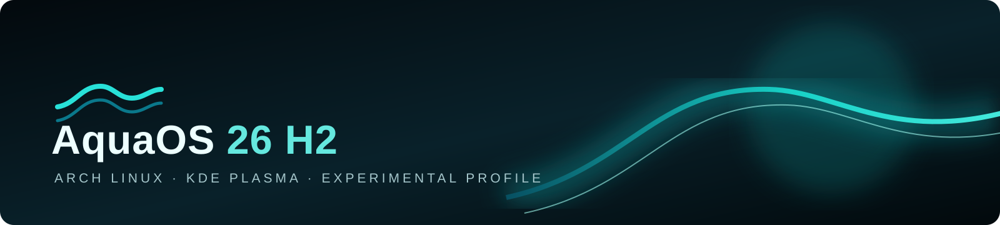

# AquaOS 26 H2



## **FINANCIADO POR QUACK LABS Y FLX**

**ADVERTENCIA DE USO COMERCIAL: Antes de utilizar AquaOS con fines comerciales, contacta con Oli Desarrollador en [olidesarrollador@gmail.com](mailto:olidesarrollador@gmail.com).**

**AquaOS se basa en Arch Linux y KDE Plasma. Este repositorio contiene un perfil experimental de Archiso, no un sistema listo para instalar.**

> **Estado:** todavía no hay una ISO de AquaOS publicada ni validada. El ZIP del proyecto es el código fuente: **no es una imagen de arranque ni se instala directamente**. La ISO se tendrá que publicar aparte.

## Probar AquaOS en Oracle VirtualBox

### Descargas

- **Proyecto completo en ZIP:** [descargar AquaOS desde GitHub](https://github.com/olidesarrollador-png/aquaos-26-h2/archive/refs/heads/main.zip). Incluye el perfil y los archivos fuente; no es el sistema arrancable.
- **ISO de AquaOS para VirtualBox:** todavía no disponible. No hay un archivo ISO real que enlazar: el perfil aún no se ha construido ni probado. Cuando exista una ISO comprobada, se publicará por separado en [Versiones de AquaOS](https://github.com/olidesarrollador-png/aquaos-26-h2/releases).
- **Oracle VirtualBox:** descárgalo desde la [página oficial de Oracle](https://www.oracle.com/virtualization/technologies/vm/downloads/virtualbox-downloads.html).

No uses el ZIP como si fuera la ISO ni lo flashees en un pendrive.

### Crear la máquina virtual cuando se publique la ISO

1. Abre VirtualBox y selecciona **Nueva**.
2. Ponle el nombre **AquaOS 26 H2** y elige **Linux → Arch Linux (64 bits)**.
3. Asigna al menos **4 GB de RAM** y **2 procesadores** si el equipo lo permite.
4. Crea un disco VDI virtual de **40 GB o más**, reservado dinámicamente.
5. En la configuración de la VM, activa **EFI** para el arranque UEFI del perfil.
6. En **Almacenamiento**, monta la ISO de AquaOS y guarda los cambios.
7. Inicia la VM y prueba primero el escritorio live. En KDE, **Instalar AquaOS 26 H2** abre la bienvenida de AquaOS y después la utilidad estándar de Arch Linux, `archinstall`.

La instalación solo debe modificar el disco virtual. AquaOS aún no tiene un instalador gráfico propio y su proceso completo de instalación no está validado. No lo instales en un disco real con datos importantes.

### Crear un pendrive de arranque cuando se publique la ISO

1. Descarga la ISO de AquaOS y una herramienta de escritura, como [Rufus](https://rufus.ie/) o [balenaEtcher](https://etcher.balena.io/).
2. Conecta un pendrive vacío y selecciónalo en la herramienta.
3. Selecciona la **ISO de AquaOS** y escribe la imagen.
4. Arranca el ordenador desde el pendrive con el menú de arranque UEFI.

**La escritura borra el contenido del pendrive. Guarda antes los archivos que quieras conservar.** No descomprimas la ISO ni copies el ZIP al pendrive: la herramienta debe escribir la ISO como imagen de arranque.

## Qué es AquaOS

AquaOS 26 H2 es un prototipo de perfil Archiso para un entorno live x86_64 basado en Arch Linux, con KDE Plasma y aplicaciones de escritorio. El repositorio incluye el perfil y el ZIP fuente original; todavía no contiene una ISO publicada, un escritorio propio ni un instalador gráfico terminado.

## Componentes y aplicaciones

- **Sistema base:** Arch Linux, kernel Linux, firmware y entorno live de Archiso.
- **Escritorio:** KDE Plasma, KWin, SDDM, Dolphin, Ark, Kate y Preferencias del sistema.
- **Terminal:** Konsole.
- **Juegos:** Steam; necesita `multilib` habilitado en la configuración de compilación.
- **IA local:** Ollama instalado sin modelos, agente ni chatbot.
- **Navegador:** Google Chrome es el navegador previsto, pero no está incluido ni configurado como predeterminado. La versión de Arch se distribuye mediante AUR; instalarlo no forma parte del perfil actual.
- **Instalación:** una bienvenida de AquaOS abre `archinstall`. Las particiones y la instalación las gestiona Arch Linux, no un instalador AquaOS propio.

La selección completa está en [`profile/packages.x86_64`](profile/packages.x86_64); aún no se ha verificado en una ISO construida.

Incluye también Mesa y Vulkan, Wayland, Xorg y XWayland, Qt Wayland, portales KDE, PipeWire y WirePlumber, Bluetooth, CUPS, UDisks, administración de energía, fwupd, OpenSSH, NetworkManager, Git, curl, wget, rsync, zip/unzip, nano, Vim, htop, Fastfetch, GRUB y herramientas de Archiso. Esta lista describe el perfil, no confirma que una ISO ya los incluya correctamente.

<details>
<summary>Lista exacta de paquetes del perfil</summary>

```text
base
linux
linux-firmware
mkinitcpio
mkinitcpio-archiso
archinstall
dialog
sudo
networkmanager
openssh
plasma-desktop
plasma-workspace
kwin
sddm
konsole
dolphin
ark
kate
systemsettings
plasma-nm
plasma-pa
xdg-desktop-portal
xdg-desktop-portal-kde
qt6-wayland
wayland
xorg-server
xorg-xwayland
mesa
vulkan-icd-loader
pipewire
pipewire-alsa
pipewire-pulse
wireplumber
bluez
bluez-utils
cups
udisks2
power-profiles-daemon
fwupd
git
curl
wget
rsync
unzip
zip
nano
vim
htop
fastfetch
flatpak
steam
ollama
grub
vlc
libreoffice-fresh
```

</details>

## Apariencia prevista

Las ilustraciones son **arte vectorial conceptual**, no capturas de AquaOS ejecutándose. El perfil actual usa KDE Plasma estándar con ajustes iniciales de KWin.

### Concepto del escritorio


### Fondos de pantalla propuestos


*Son propuestas visuales; todavía no están instaladas como fondos del sistema.*

### Terminal e instalación


*Konsole sí está en el perfil. La imagen del instalador es conceptual: la herramienta real es `archinstall`.*

El perfil aún no incluye dock propio, centro de control, tema completo, colección de fondos instalada o instalador gráfico AquaOS.

## Licencias AquaOS y claves

El prototipo no comprueba licencias, bloquea funciones ni requiere claves. La licencia gratuita y AquaOS Pro son planes de producto, pero todavía no existe un sistema de emisión o validación. AquaOS Pro sigue en desarrollo; el precio único previsto de 9 USD y su cobertura para AquaOS 26 H2, AquaOS 27 H2 y versiones futuras no están disponibles para compra. AquaOS Server y sus claves tampoco forman parte de este prototipo.

No se han inventado claves: un código publicado en un repositorio público no es secreto ni irreplicable. Consulta el [estado de licencias y claves](licenses/README.md). Este mismo repositorio publicará instrucciones oficiales si se desarrolla ese sistema. Arch Linux, KDE Plasma, Steam, Ollama y las demás aplicaciones mantienen sus propias licencias y condiciones.

## Windows y Mac

- **Windows:** usa VirtualBox para probar la ISO cuando se publique. Para compilar desde el perfil fuente, se recomienda una VM Arch Linux x86_64. WSL2 puede servir para editar, pero no se garantiza que pueda construir o arrancar esta ISO.
- **Mac Intel:** usa una VM Arch Linux x86_64; no se garantiza compatibilidad nativa con el hardware de cada Mac.
- **Apple Silicon:** los Mac con Apple Silicon no son compatibles con esta imagen x86_64.

## Compilar la ISO (opcional, para desarrolladores)

Las instrucciones de uso normal no requieren comandos: se descargará la ISO publicada en [Versiones](https://github.com/olidesarrollador-png/aquaos-26-h2/releases) y se abrirá en VirtualBox o se escribirá en un pendrive. Compilar desde el perfil fuente sí requiere Arch Linux y herramientas de desarrollo:

<details>
<summary>Instrucciones técnicas de compilación en Arch Linux</summary>

```bash
sudo pacman -Syu
sudo pacman -S --needed git archiso
git clone https://github.com/olidesarrollador-png/aquaos-26-h2.git
cd aquaos-26-h2
sudo ./scripts/check-profile.sh
sudo ./scripts/build-iso.sh
```

La salida queda en `out/` y los temporales en `work/`. La compilación necesita Internet y no se ha ejecutado ni validado todavía.

</details>

## Descargas del proyecto

- [Descargar todos los archivos del proyecto en ZIP](https://github.com/olidesarrollador-png/aquaos-26-h2/archive/refs/heads/main.zip)
- [Consultar o descargar archivos fuente](https://github.com/olidesarrollador-png/aquaos-26-h2)
- [Consultar futuras versiones e ISO](https://github.com/olidesarrollador-png/aquaos-26-h2/releases)

El ZIP contiene el perfil, scripts y arte conceptual. No sustituye la ISO ni arranca en VirtualBox o desde un pendrive.

## Limitaciones actuales

- No se ha publicado, compilado ni probado una ISO de AquaOS.
- La opción del menú abre `archinstall`; no hay instalador gráfico propio.
- No se han medido RAM, compatibilidad de hardware ni rendimiento de juegos.
- Chrome no está instalado ni seleccionado como navegador predeterminado.
- Ollama no incluye modelos ni agente de IA.
- Las licencias gratuitas/Pro/Server y sus claves no están implementadas.
- Los fondos de pantalla conceptuales no forman parte del sistema instalado.

## Estructura del repositorio

```text
artifacts/original/       ZIP fuente original
assets/                   Banner e ilustraciones vectoriales conceptuales
licenses/                 Estado de licencias y claves
profile/                  Perfil Archiso y sistema live
scripts/                  Herramientas de compilación y revisión
```
