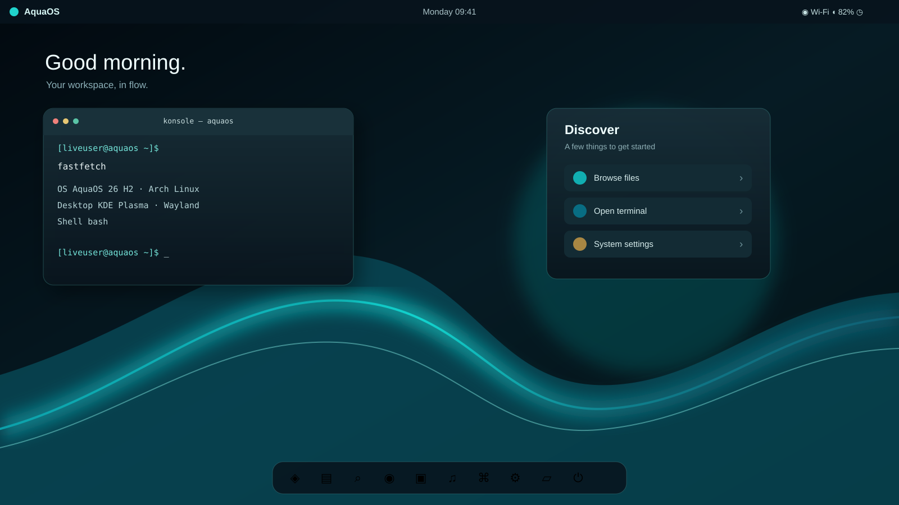
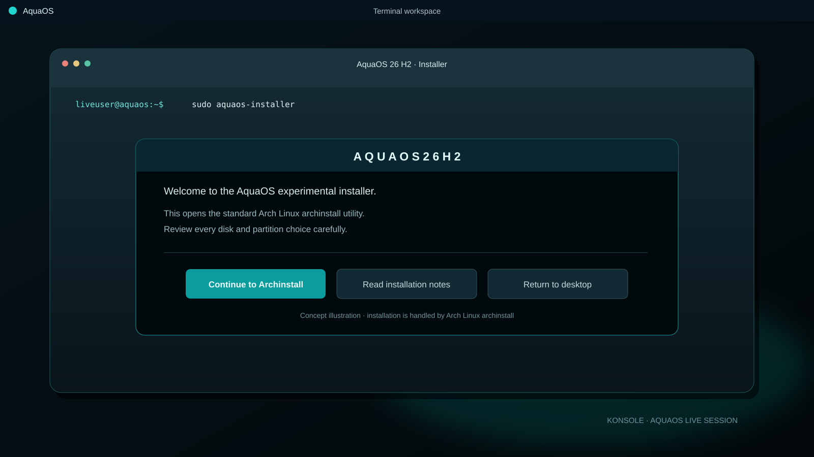

# AquaOS 26 H2

## **FUNDED BY QUACK LABS AND FLX**

**COMMERCIAL USE WARNING: Contact Oli Desarrollador at [olidesarrollador@gmail.com](mailto:olidesarrollador@gmail.com) before using AquaOS for commercial purposes.**

**An experimental Arch Linux based desktop profile from Quack Labs.**

> **Project status:** prototype Archiso profile. AquaOS is not a finished operating system or a production ready ISO. The profile has not yet been built and validated end to end on a supported Arch Linux host. Treat any resulting image as experimental and test it in a virtual machine.

## What AquaOS is

AquaOS 26 H2 is an early project for shaping an Arch Linux based desktop around KDE Plasma, gaming, developer tools, and a future AquaOS visual identity. This repository contains a build profile and scripts. It does not contain a released ISO, a custom desktop environment, or a finished graphical installer.

The current profile targets **x86_64 UEFI** systems. Package versions come from the Arch repositories at build time, so repeat builds can differ.

## Included in the profile

- Arch Linux live system with the Linux kernel and firmware.
- KDE Plasma desktop, SDDM, Konsole, Dolphin, and common desktop utilities.
- Steam, subject to the Arch `multilib` repository being enabled in the build configuration.
- Ollama package only. No model is downloaded or bundled, and no AI agent or chatbot is included.
- Google Chrome is the intended default browser, but it is **not currently installed or configured as the default**. The Arch package is distributed through the AUR and is not available to the standard `mkarchiso` package list. Install it manually after installing Arch, using a trusted AUR helper or by reviewing and building the `google-chrome` AUR package as a normal user.
- Basic AquaOS identity metadata and a small KWin configuration. These are early defaults, not a complete branded theme or custom desktop.

## Visual direction and planned features

The visual direction is a dark, OLED-friendly KDE desktop with deep black surfaces, aqua/cyan accents, restrained transparency, and soft window transitions. The images below are hand-built **vector concept art**, not screenshots of a running AquaOS image.

### AquaOS desktop concept



*Concept only. The current profile still uses stock KDE Plasma with starter KWin settings.*

### Proposed wallpaper concepts


*Proposed wallpapers only; neither is installed in the current profile.*

### Terminal and installer concept



*Concept art. Konsole is included. The actual live image opens Arch Linux `archinstall` from an AquaOS-branded terminal welcome screen.*

The profile currently includes KDE Plasma, KWin, Konsole, starter settings for blur, contrast, fade, and slide effects, and an AquaOS-branded launcher for `archinstall`. A custom graphical installer, dock, control center, branded desktop theme, and installed wallpaper collection remain future work.

## Build on Arch Linux

Build from an up-to-date x86_64 Arch Linux installation with internet access. The image build uses Arch repositories and requires root privileges for `mkarchiso`.

```bash
sudo pacman -Syu
sudo pacman -S --needed git archiso
git clone https://github.com/olidesarrollador-png/aquaos-26-h2.git
cd aquaos-26-h2
sudo ./scripts/check-profile.sh
sudo ./scripts/build-iso.sh
```

The package list lives in `profile/packages.x86_64`; edit it to change the image contents. `profile/pacman.conf` includes the `multilib` repository used for Steam.

The ISO is written to `out/`; temporary build files go to `work/`. The first build downloads packages and can take a while. Steam and LibreOffice make the image large. Keep both directories out of version control.

The build wrapper creates the SDDM and NetworkManager systemd enablement symlinks for the profile overlay, then removes those temporary links when the build exits. This also avoids relying on Windows ZIP extraction to preserve Unix symlinks.

The live desktop includes an AquaOS-branded installer entry with a welcome and safety notes, then opens Arch Linux `archinstall`. Disk partitioning and installation remain in `archinstall`; there is no custom AquaOS graphical installer. The profile has not yet been validated as a complete install workflow.

## Windows

Use an x86_64 Arch Linux virtual machine for building and testing. Give the VM enough disk space for the package cache, working tree, and ISO output. Clone this repository inside the Arch VM and follow the Arch build commands above.

WSL2 can be useful for editing files. Building through WSL2 may depend on loop-device, mount, and privilege support in the particular WSL setup, so a full Arch Linux VM is the recommended route for building the ISO and testing its boot behavior. Test the ISO in a VM; do not install the prototype on a Windows host or real disk.

## Intel Mac

On an Intel Mac, use an x86_64 Arch Linux virtual machine to build or test the image. Follow the Arch Linux instructions inside that VM. This is experimental and does not promise native Mac hardware support, Wi-Fi, graphics acceleration, or a working boot on every Intel Mac.

**Apple Silicon Macs are not supported by this x86_64 image.**

## Linux testing and installation guidance

On an x86_64 Linux host, use a virtual machine to boot the ISO first. Verify that the live desktop starts, networking and audio work, and the included applications launch before considering further use.

Choose **Install AquaOS 26 H2** from the KDE application menu to open the branded welcome screen and launch `archinstall`. Review its disk and partition selections yourself. The profile has no custom graphical AquaOS installer and no tested production installation path. Do not install on a machine or disk containing data you need.

## Applications and packages declared in the profile

This is the profile's package selection, not a verified list from a completed ISO.

- **Desktop and terminal:** KDE Plasma (`plasma-desktop`, `plasma-workspace`), KWin, SDDM, Konsole, Dolphin, Ark, Kate, System Settings, Plasma Network and Audio integrations.
- **User applications:** Steam, Ollama (no models and no AI agent), VLC, LibreOffice Fresh, Flatpak.
- **Tools and services:** NetworkManager, OpenSSH, dialog (installer welcome screen), PipeWire audio, Bluetooth utilities, CUPS, UDisks, power-profiles-daemon, fwupd, Git, curl, wget, rsync, zip/unzip, nano, Vim, htop, Fastfetch.
- **Graphics and display stack:** Mesa, Vulkan loader, Wayland, Xorg, XWayland, Qt Wayland, KDE XDG desktop portal.
- **Chrome:** not included. It remains the intended browser choice, but it must be installed from the AUR after installation and is not configured as the default.
- **GRUB:** included for the live ISO's UEFI boot path; it is a boot component, not a desktop application.

<details>
<summary>Full package list declared in profile/packages.x86_64</summary>

<pre>
base
linux
linux-firmware
mkinitcpio
mkinitcpio-archiso
archinstall
dialog
sudo
networkmanager
openssh
plasma-desktop
plasma-workspace
kwin
sddm
konsole
dolphin
ark
kate
systemsettings
plasma-nm
plasma-pa
xdg-desktop-portal
xdg-desktop-portal-kde
qt6-wayland
wayland
xorg-server
xorg-xwayland
mesa
vulkan-icd-loader
pipewire
pipewire-alsa
pipewire-pulse
wireplumber
bluez
bluez-utils
cups
udisks2
power-profiles-daemon
fwupd
git
curl
wget
rsync
unzip
zip
nano
vim
htop
fastfetch
flatpak
steam
ollama
grub
vlc
libreoffice-fresh
</pre>

</details>

## AquaOS free and Pro licenses

The current prototype has no license checks, paid feature locks, or AquaOS activation keys. It can be built and tested without an AquaOS key. The free license and AquaOS Pro are planned product tiers, but no license service or key format exists yet. AquaOS Pro is in development; its proposed one-time USD 9 price and coverage of AquaOS 26 H2, AquaOS 27 H2, and later versions are plans only, not an offer for sale. AquaOS Server and its keys are not part of this prototype. See [license and key status](licenses/README.md). This repository will be the place to publish official licensing instructions if that system is implemented.

## Repository layout

```text
artifacts/original/       User-provided source ZIP, retained unchanged
assets/                   Hand-built SVG visual concepts
licenses/                 Current licensing and key status
profile/                  Archiso profile and live root filesystem overlay
scripts/build-iso.sh      mkarchiso build wrapper
scripts/check-profile.sh  Basic profile consistency checks
```

## Known limitations

- No ISO has been released or verified by CI.
- No custom AquaOS desktop environment or graphical installer exists yet; the menu entry launches Arch Linux `archinstall`.
- No low-RAM target, animation design, hardware compatibility, or gaming performance claim has been measured.
- Chrome is not in the live image and is not automatically selected as the default browser.
- Ollama has no model, agent, or chat interface included.
- AquaOS free/Pro/Server license activation and key issuance are not implemented.
- The live desktop and install flow still need an end-to-end build and VM validation pass.

## License and third-party software

The repository's configuration files are provided for experimentation under the included license notice. Arch Linux, KDE Plasma, Steam, Ollama, Google Chrome, and other bundled or referenced components are governed by their respective upstream licenses and terms. AquaOS does not imply endorsement by those projects.
